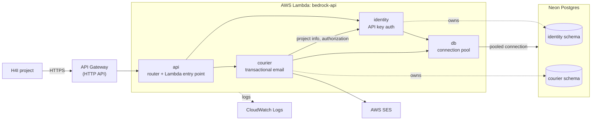

# bedrock

An API providing shared foundational services for H4I projects:

* Transactional email (AWS SES)
* Per-project API key authentication

More services (e.g. analytics, logging and alerting) can be added later. Inspired by GT Bits of Good's [juno](https://github.com/GTBitsOfGood/juno).

## Architecture



`bedrock` is a modular monolith. Each service is a library crate in `crates/`, and all of them compile into one
Lambda binary. To add a service, simply add another crate and expose its public API.

## Local development

### Prerequisites

* Rust (stable). Install it with [rustup](https://rustup.rs).
* cargo-lambda
* Terraform 1.11 or later (only if you need to modify AWS infra)

### Start the API

1. Start the local Lambda emulator:
   ```sh
   cargo lambda watch
   ```
2. Send a request to the API:
   ```sh
   curl localhost:9000/
   ```
### CI checks

CI does these checks on each pull request.

```sh
cargo fmt --all --check
cargo clippy --workspace --all-targets -- -D warnings
cargo test --workspace
cargo lambda build --release --arm64 --bin api
terraform fmt -check -recursive infra
```

To correct format errors, use `cargo fmt --all` and `terraform fmt -recursive infra`.

## Deployment

Pushes to main trigger deployments automatically with Terraform. See the deploy GitHub action for details.

### Bootstrap AWS setup

Do this once per AWS account. If you are reading this on the main repo, you can ignore.

1. With admin AWS credentials, create the state bucket, GitHub OIDC provider and deploy role:
   ```sh
   terraform -chdir=infra/bootstrap init
   terraform -chdir=infra/bootstrap apply
   ```
   If the account already has a GitHub OIDC provider, add `-var create_oidc_provider=false`. Bootstrap state is
   local only (`infra/bootstrap/terraform.tfstate`), so back it up.
2. In GitHub, create a `production` environment limited to `main`. Give it a variable `AWS_DEPLOY_ROLE_ARN` set to the
   `deploy_role_arn` output.
